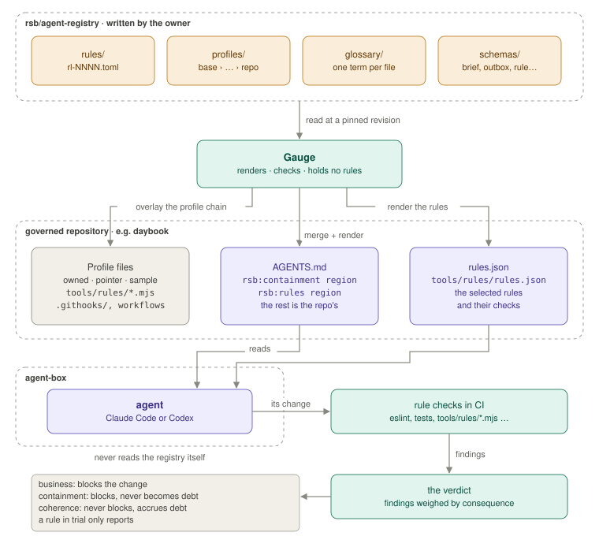
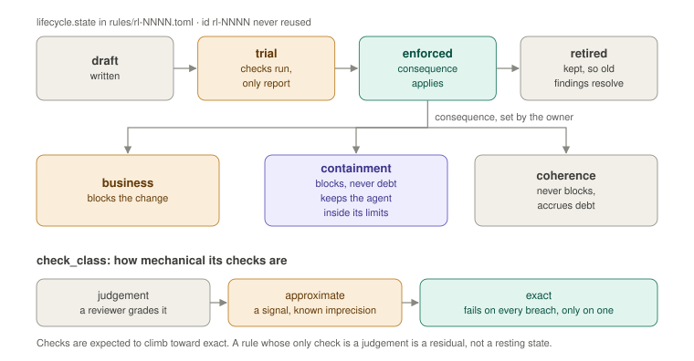
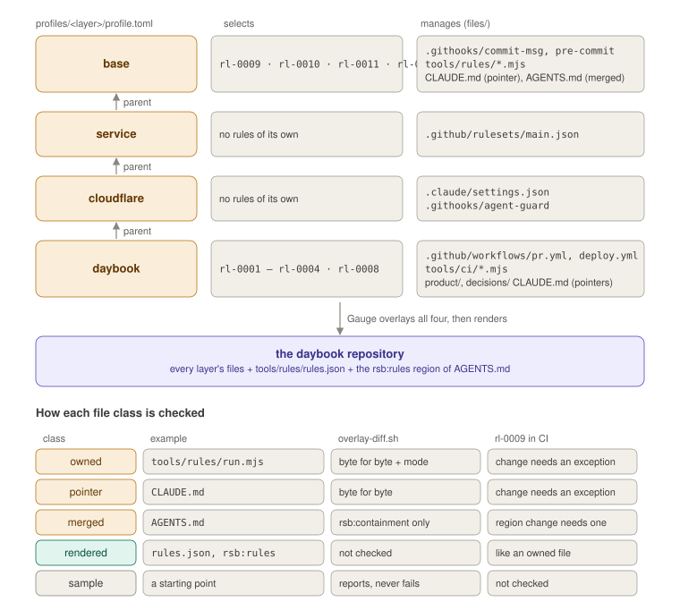

# agent-registry

The rules, profiles, standards, schemas and vocabulary that the coding
agents of `rsb-workflow` are held to. It is data, not code: TOML, JSON
Schema, Markdown and the template files a governed repository is built
from. There is nothing to install.

`rsb-workflow` is a software factory. It takes an accepted ticket to a
merged change, with an agent as the implementer and evidence in place of
review. Its pieces:

- [Gauge](https://github.com/rsb/gauge), the engine, reads this
  repository, renders what an agent sees from it, and checks the agent's
  work against it. Gauge holds no rule content of its own.
- [agent-box](https://github.com/rsb/agent-box) is the sandbox an agent
  runs in.
- Agents never read this repository directly. They read the `AGENTS.md`
  region and `rules.json` that Gauge renders from it, at a pinned
  revision.



You may find it useful as a worked example of governing coding agents
with explicit, versioned, checkable rules rather than prompt text. It is
not a general-purpose policy engine, and the formats change as the
factory does.

## Contents

- [What this repo is not](#what-this-repo-is-not)
- [Layout](#layout)
- [Rules](#rules)
- [Profiles](#profiles)
- [How governance files are checked](#how-governance-files-are-checked)
- [Schemas](#schemas)
- [Glossary](#glossary)
- [Standards](#standards)
- [Checking the registry](#checking-the-registry)
- [The rsb family](#the-rsb-family)
- [Contributing and security](#contributing-and-security)
- [License](#license)

## What this repo is not

The registry holds how software is shaped — rules, heuristics, checks,
patterns, profiles — never secrets, data, telemetry or provider
configuration. Credentials live with the custodian, run data and
scorecards live with Gauge and the governed repositories, and a profile
names what a provider must be configured with, never the values.

## Layout

| Path | What it holds |
|---|---|
| `rules/` | one TOML file per rule, `rules/rl-NNNN.toml` |
| `heuristics/` | one TOML file per heuristic, `heuristics/hr-NNNN.toml` (none yet) |
| `profiles/` | the layers a repository is minted and reconciled from: a `profile.toml` and a `files/` tree each |
| `schemas/` | JSON Schema for every format that crosses between the owner, the agent and the custodian, with fixtures and `check.py` |
| `glossary/` | one TOML file per term of the factory's vocabulary |
| `standards/` | prose standards shared by the Rust apps |
| `repos.toml` | every repository in the portfolio, its role, local path and status |

`rules/` and `profiles/` move together at one revision, so a rule and
the profile that selects it land in one commit. A PR changes one of the
two trees, or both when they change for one reason.

## Rules

A rule is a statement about the code that must hold. It has an opaque id
(`rl-NNNN`, assigned in creation order, never reused) and at least one
check. A retired rule keeps its file and id, so old findings stay
readable. Example (`schemas/rule/v1/fixtures/valid/containment.toml`):

```toml
id          = "rl-0043"
statement   = "Workflows pin actions by commit SHA and declare permissions."
why         = "A moved tag runs foreign code with the repo's token."
check_class = "exact"
consequence = "containment"

[scope]
paths = [".github/workflows/**"]

[lifecycle]
state = "enforced"
since = "2026-10-28"

[[checks]]
kind = "script"
ref  = "tools/rules/workflow-pins.mjs"
```

- `statement`: one line. `why`: the reason, also one line.
- `scope`: the `paths` it covers and any it `exclude`s.
- `check_class`: how mechanical its checks are: `exact`, `approximate` or
  `judgement`. Checks are expected to climb toward exact; a rule whose
  only check is a judgement is a residual, not a resting state.
- `consequence`, set by the owner, for an enforced rule (a rule in
  `trial` only reports):
  - `business`: blocks the change.
  - `containment`: blocks, and never becomes debt. For rules that keep
    the agent inside its limits.
  - `coherence`: never blocks; accrues debt.
- `lifecycle`: `state` (`draft`, `trial`, `enforced`, `retired`) and `since`.
- `checks`: each a `kind` (`eslint`, `clippy`, `ast-grep`,
  `dependency-cruiser`, `xtask`, `test`, `script`, `review`) and a `ref`.



A rule that restates a numbered rule in an app's own `engineering/` docs
carries `source = { file, number }` and a `why` that points at it. That
pointer retires once Gauge renders the rule and the text moves here.

A heuristic is a weighed default with permission to deviate: like a rule
without a consequence, and it must record at least one counter-case. A
rule must not have one. The format is `schemas/heuristic/v1`.

## Profiles

Profiles are layers chained `base › kind › variant › repo`, for example
`base › service › cloudflare › daybook`. Each layer's `profile.toml`
names its parent, the rules it selects, and the files it manages with
their class:

```toml
name   = "cloudflare"
parent = "service"
rules  = []

[files]
".claude/settings.json" = "owned"
".githooks/agent-guard" = "owned"
```



Rule text lives here for every layer, repository leaves included.
`profiles/tools/overlay-diff.sh` compares a repository with its chain.

## How governance files are checked

A managed file has one of five classes.

- Owned: has a template in a layer's `files/`. `overlay-diff.sh`
  compares it with the repo byte for byte and by mode; in CI, rl-0009
  reports any change to it that has no recorded exception.
- Pointer: compared byte for byte, like an owned file (`CLAUDE.md`).
  `overlay-diff.sh` and rl-0009 check it in the same way.
- Merged: `AGENTS.md`. Only its `rsb:containment` region is compared;
  the rest of the file is the repo's. `overlay-diff.sh` compares the
  region with the template's, and in CI rl-0009 reports a change to it
  that has no recorded exception.
- Rendered: `tools/rules/rules.json` and the `rsb:rules` region of
  `AGENTS.md`. The render produces them, and no layer carries a copy, so
  `overlay-diff.sh` does not check them. In CI, rl-0009 reports changes
  to them like changes to an owned file.
- Sample: a starting point the repo is free to change. `overlay-diff.sh`
  reports a difference without failing, and rl-0009 does not check it.

## Schemas

JSON Schema 2020-12 for every format that crosses a boundary: spec and
ticket frontmatter, the brief (one attempt's task and limits, written by
the custodian), the outbox (the effects the agent intends, applied by the
custodian), and the rule and heuristic formats. See
[schemas/README.md](schemas/README.md) and
[schemas/outbox/v1/README.md](schemas/outbox/v1/README.md).

`schemas/rule/v1` and `schemas/heuristic/v1` are copies generated from
Gauge's `rsb-gauge-schema` crate, which is the schema; regenerate them
with `gauge registry schema rule` and `gauge registry schema heuristic`.

## Glossary

The factory's ubiquitous language: when a name appears in a rule, a
brief, a render or a scorecard, it means what its file in `glossary/`
says. The glossary is covered by the render hash, so a glossary change is
a registry change. Format in [glossary/README.md](glossary/README.md).

## Standards

One file per standard in `standards/`, each with a Why, a Paths and a
Check section. An app's `engineering/` holds a pointer to the standard,
the app's boundary, and the check that enforces it there. A standard
enters `standards/` only when a second app needs it.

- `errors.md`: one snafu enum per crate, `{e}` is the whole line, with
  the file and line of each layer on by default.
- `panics.md`: a panic is a bug report, an error is an outcome; the
  process survives it.
- `logging.md`: log or return, never both; one line at the boundary.

The runtime pieces and the checks live in the `rsb-errors` crate,
repository `rsb/errors-rs`, pinned by tag (`v0.1.1`).

## Checking the registry

Needs Python 3.11 or later with `jsonschema` and `PyYAML`.

```sh
python3 schemas/check.py fixtures   # every fixture passes or fails as its path says
python3 schemas/check.py registry   # rules/*.toml and heuristics/*.toml
gauge registry lint .               # with Gauge installed
```

The profile scripts carry their own tests, run with `node --test` from a
layer's `files/` directory.

## The rsb family

The registry also records the conventions of the `rsb` family of
repositories and apps.

### Apps

| App | What it is | Repository |
|---|---|---|
| Lumen | raw developer and photo catalog | `rsb/lumen` |
| Pigment | pixel editor | not started |
| Pica | page layout | not started |
| Spline | vector drawing | not started |
| Datum | CAD | not started |

The theme is the base unit of each medium. Each app's README names its own
reference apps.

RSB Workflow's own pieces are not suite apps:

| Piece | What it is | Where |
|---|---|---|
| Gauge | the engine: registry, renders, sensing, the verdict, rule statistics; CLI `gauge` | `rsb/gauge` |
| Insights | the owner's desktop view across the workflow and all projects; composes what the CLI offers, holds no domain logic | package in `rsb/gauge` |
| `agent-driver` | the only binary that holds the GitHub App key; observes and acts on GitHub, runs the tick | package in `rsb/gauge` (`crates/agent-driver`) |

### Naming

- `rsb` is the organisation and the brand in every machine-facing name. It is
  always lowercase. `rsb.lab` appears only in prose about the photography and
  in About text.
- Repositories are `rsb/<name>` on GitHub and live locally under
  `~/code/software/rsb/` at the path `repos.toml` gives them, with the
  same `<name>`. The top level is one folder per role: `factory/`,
  `projects/` (split by kind: `services/`, `desktop/`, `lib/`), `ref/` and
  `research/`. A folder is for the owner; a repository declares its own
  kind and profile, and no tool infers them from the folder.
- Names come from vocabularies. Creative names from the art vocabulary
  (Lumen, Pigment, Pica, Spline, Datum) are reserved for the creative
  suite. A system with its own identity takes a proper name from another
  vocabulary: Gauge is from metrology. Infrastructure is descriptive.
- The `agent-` prefix marks a subsystem that serves only the agent, whether
  it is a repository or a workspace package: `agent-box`, `agent-host`,
  `agent-registry`, `agent-driver`. In `agent-driver` it also marks the
  custody boundary. `rsb-skills` and `research` serve the owner too and
  carry none.
- Binaries: the bare name belongs to the primary surface. A desktop-first
  app's GUI is `<app>` and any headless tool is `<app>-cli` (`lumen`,
  `lumen-cli`). A headless-first system's CLI is the bare name (`gauge`).
- Crates inside one workspace are bare unless they are meant for use
  outside it; crates shared across apps carry the prefix `rsb-`
  (`rsb-errors`, `rsb-libraw`). Gauge's library crates are layered and
  named `rsb-gauge-*` (`rsb-gauge-schema` first); its CLI crate is
  `rsb-gauge-cli` (binary `gauge`).
- Configuration lives in `~/.config/rsb/<app>/`, data in
  `~/.local/share/rsb/<app>/`. The monitor-to-ICC-profile map is shared by all
  apps at `~/.config/rsb/monitors.toml`.
- App ids are the reverse of a domain we hold, fixed before the first desktop
  entry ships. The domain is `rsb.sh`.
- App names are capitalised in UI text and lowercase in every id, path,
  crate name and binary.
- Names from the archived attempts are never reused: lab, studio, atlas,
  observatory. Easel named the archived UI toolkit, was reissued on
  2026-10-19 to the workflow's control center, and was retired from it on
  2026-10-23 when the engine became Gauge. Whether Easel returns to the
  creative suite is open.

Naming is the one standard kept here before a second app needs it,
because it is family-level by definition.

### Repositories

The full list, with roles and paths, is `repos.toml`. Roles are
`factory` (what the loop runs on), `project` (what the loop produces),
`reference` (a profile's reference app) and `record`. A loop may open only
on a `project` or `reference` repo that carries `.rsb/governance.lock`.
Notes on some:

- `rsb/agent-registry`: this repository. Renamed from `rsb/rules` on
  2026-10-19.
- `rsb/gauge`: RSB Workflow's engine monorepo (the `rsb-gauge-*`
  libraries, CLI `gauge`, `agent-driver`, Insights later). Renamed from
  `rsb/easel`.
- `rsb/agent-driver`: archived. Its key, token and GitHub client code
  moved into `rsb/gauge`; its gatekeeper design (an agent asking it to act
  mid-run) was replaced by the brief and outbox.
- `rsb/agent-box`: the sandbox; the only place an agent runs.
- `rsb/agent-host`: the at-desk sandbox configuration, kept in git.
- `rsb/rsb-skills`: how the owner and agents work.
- `rsb/research`: research, decisions, handoffs and retrospectives, one
  folder per effort; `rsb-workflow/` is RSB Workflow's. Renamed from
  `rsb/notes` on 2026-10-19. Never referenced from an app's `AGENTS.md`.
- `rsb/errors-rs`: the `rsb-errors` crate, runtime pieces and checks of
  the errors, panics and logging standards. Public, because `rsb/libraw`
  is public and depends on it.
- `rsb/<app>`: one repository per app, holding its code, its `engineering/`
  rules with their checks, and its `product/` truth.

## Contributing and security

This is a single-owner project: rules and consequences are the owner's
call, so outside pull requests are not expected. Issues pointing out a
mistake are welcome. If you find a leaked private detail, or a rule or
profile file that would weaken an agent's limits, please report it
privately (see [SECURITY.md](SECURITY.md)) rather than in a public issue.
The rules for issues and pull requests are in
[CONTRIBUTING.md](CONTRIBUTING.md).

## License

[MIT](LICENSE).
